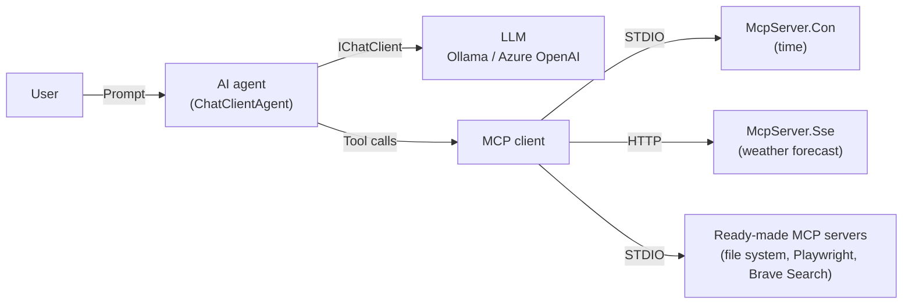

# Shos.AIAgentSample

[](https://opensource.org/licenses/MIT)
[](https://dotnet.microsoft.com/)
[](https://docs.microsoft.com/dotnet/csharp/)

[日本語](./README.md) | **English**

**Hands-on learning material for building AI agents with C# / .NET, step by step from scratch.**

This repository contains the sample code and the Japanese tutorials for the "AI Agent Development Hands-on Seminar (for developers)". You build an AI agent with **Microsoft Agent Framework**, then let it use external tools through the **Model Context Protocol (MCP)**, running the code at every step as you go.

**Repository**: https://github.com/Fujiwo/Shos.AIAgentSample

> [!NOTE]
> The tutorials (`Documents/`), the seminar slides (PDF) and the comments in the source code are written in Japanese.

## Table of Contents

- [About This Repository](#about-this-repository)
- [Key Points](#key-points)
- [Overview](#overview)
- [Projects](#projects)
- [Manual](#manual)
  - [Step 1: Prepare the Prerequisites](#step-1-prepare-the-prerequisites)
  - [Step 2: Get and Build the Repository](#step-2-get-and-build-the-repository)
  - [Step 3: Prepare an LLM](#step-3-prepare-an-llm)
  - [Step 4: Adjust the Code Settings to Your Environment](#step-4-adjust-the-code-settings-to-your-environment)
  - [Step 5: Run the Console AI Agents](#step-5-run-the-console-ai-agents)
  - [Step 6: Run and Check the MCP Servers](#step-6-run-and-check-the-mcp-servers)
  - [Step 7: Use MCP Server Tools from the AI Agent](#step-7-use-mcp-server-tools-from-the-ai-agent)
  - [Step 8: Run the Web Chat](#step-8-run-the-web-chat)
  - [Step 9: Run the CAD App](#step-9-run-the-cad-app)
  - [Step 10: Clean Up](#step-10-clean-up)
- [Build It Yourself with the Tutorials](#build-it-yourself-with-the-tutorials)
- [File Structure](#file-structure)
- [Tech Stack](#tech-stack)
- [Glossary](#glossary)
- [Troubleshooting](#troubleshooting)
- [Notes](#notes)
- [License](#license)
- [Author](#author)
- [Acknowledgments](#acknowledgments)
- [Contributing](#contributing)

## About This Repository

In this repository, you learn the following in order.

| What you learn | Description | Project |
|---|---|---|
| **AI agent basics** | Build the smallest AI agent that asks an LLM a question and receives the answer | FCAIAgent1 |
| **Switching LLMs** | Switch between local Ollama and cloud Azure OpenAI | FCAIAgent2 |
| **Continuing a conversation** | Talk back and forth while the agent remembers what was said before | FCAIAgent3 |
| **Building MCP servers** | Build servers that provide tools to an AI agent, using two transports: STDIO and HTTP | McpServer.Con / McpServer.Sse |
| **Using MCP server tools** | Use the tools of your own servers and of ready-made servers from an AI agent | FCAIAgent4 / FCAIAgent5 |
| **Embedding in apps** | Embed an AI agent in a web chat and a desktop app | FCAIChat1–5 / FCAICad1 |

> [!IMPORTANT]
> The APIs of Microsoft Agent Framework and the MCP SDK may change between versions. This repository has been verified with `Microsoft.Agents.AI` 1.28.0 and `ModelContextProtocol` 2.4.0 (the tutorials were originally written against a preview version).

## Key Points

### 1. See the "diff" from the previous step at a glance

FCAIAgent1–5 and FCAIChat1–5 add features little by little to the code of the previous step. To make it obvious what changed, the code is marked with **`旧` (old) / `新` (new)** comments.

```csharp
// 旧: using IChatClient chatClient = GetOllamaClient();
// 新: ここから
// 使用するチャットクライアント種別
const My.ChatClientType chatClientType = My.ChatClientType.AzureOpenAI;
using IChatClient       chatClient     = My.GetChatClient(chatClientType);
// 新: ここまで
```

- The code between `// 新: ここから` ("new: from here") and `// 新: ここまで` ("new: up to here") was added or changed in this step.
- The comment after `// 旧:` ("old:") is the code of the previous step (not used in this step).
- Only the diff from the immediately preceding step is marked. The marks of the previous step are removed in the next step.

If you only want to read the finished code, see **FCAIAgent**, which is FCAIAgent5 with the marks removed.

### 2. Use local and cloud LLMs with the same code

Because the LLM is used through the common `IChatClient` interface, you can switch between **Ollama** (local, or Ollama's cloud models) and **Azure OpenAI** by changing one line.

### 3. Learn MCP from both the "server side" and the "client side"

- **Server side**: You build your own STDIO server that returns the time (McpServer.Con) and HTTP server that returns weather forecasts (McpServer.Sse).
- **Client side**: In addition to your own servers, the AI agent also uses the tools of ready-made servers (file system, Playwright and Brave Search).

### 4. Try it in three kinds of apps: console, web and desktop

| Kind | Projects | What you can do |
|---|---|---|
| Console | FCAIAgent1–5 | Talk with the AI agent in a terminal |
| Web | FCAIChat1–5 | An AI agent joins a multi-user chat (call it with `@Agent`) |
| Desktop | FCAICad1 | Give an instruction in words such as "draw a sunset at the seaside", and the AI draws an illustration |

### 5. Modern C# and careful comments

- The code uses C# 14 / .NET 10 features (primary constructors, collection expressions, extension blocks, the `field` keyword and more).
- The source code has Japanese comments written so that first-time readers can follow it.
- Types, constants and methods you define yourself are grouped in `static class My`. Anything prefixed with `My.` is your own code; anything without it comes from a library.

## Overview

An AI agent works by combining an LLM (the thinker) with tools (the hands).



1. The user sends a prompt (a question or an instruction).
2. The AI agent passes the prompt to the LLM together with the list of available tools.
3. When the LLM decides to use a tool, the AI agent calls the tool through MCP and returns the result to the LLM.
4. The LLM writes the answer based on the tool results and returns it to the user.

## Projects

### Console AI agents (FCAIAgent series)

| Project | Step | What it does | Tutorial |
|---|---|---|---|
| **FCAIAgent1** | 1 | Asks Ollama a single question and shows the answer | [1.1](./Documents/tutorial.1.1.md) |
| **FCAIAgent2** | 2 | Switches between Ollama and Azure OpenAI (`ChatClientType`) | [1.2](./Documents/tutorial.1.2.md) |
| **FCAIAgent3** | 3 | Talks back and forth while remembering the conversation with `AgentSession` | [1.3](./Documents/tutorial.1.3.md) |
| **FCAIAgent4** | 4 | Uses the time tools of an STDIO MCP server (McpServer.Con) | [3.1](./Documents/tutorial.3.1.md) |
| **FCAIAgent5** | 5 | Uses the tools of multiple MCP servers (time, weather forecast and file system) | [3.2](./Documents/tutorial.3.2.md) |
| **FCAIAgent** | Final | The same code as FCAIAgent5 with the `旧` / `新` marks removed | — |

### MCP servers

| Project | Transport | Tools provided | Tutorial |
|---|---|---|---|
| **McpServer.Con** | STDIO (standard input/output) | `GetCurrentTime` (current time), `GetTimeInTimezone` (time in a given time zone) | [2.1](./Documents/tutorial.2.1.md) |
| **McpServer.Sse** | HTTP (Streamable HTTP), listening on `http://localhost:3001/` | `GetWeatherForecast` (weather forecast for a Japanese prefecture; learning data that returns fixed values only for 北海道, 東京都, 石川県 and 福井県) | [2.2](./Documents/tutorial.2.2.md) |

> [!NOTE]
> Although McpServer.Sse has "Sse" in its name, its transport is the current Streamable HTTP. The legacy SSE endpoint (`/sse`) is disabled by default.

### Web chat (FCAIChat series)

You build a chat app with ASP.NET Core Razor Pages and SignalR, and finally let an AI agent join it. Steps 1–3 build the chat app itself and do not use an LLM.

| Project | Step | What it does |
|---|---|---|
| **FCAIChat1** | 1 | Real-time chat with SignalR. Login with ASP.NET Core Identity |
| **FCAIChat2** | 2 | Saves messages to a database (EF Core + SQL Server LocalDB) and shows past messages when the page opens |
| **FCAIChat3** | 3 | Shows messages as speech bubbles with a partial view (`_MessagePartial`) |
| **FCAIChat4** | 4 | An AI agent (Azure OpenAI) joins the chat and answers messages that contain `@Agent`. It can operate a browser with the Playwright MCP server |
| **FCAIChat5** | 5 | Can search the web with the Brave Search MCP server. Saves and restores the conversation per logged-in user. The conversation can be cleared |

### CAD app (FCAICad1)

A Windows Forms drawing (CAD) app. When you give an instruction in words such as "draw a small house in the forest", the AI agent calls the drawing tools many times to draw an illustration. It is an example of **embedding an AI agent in a desktop app and operating the app with words**.

The static methods in `Toolbox.cs` are passed to the AI agent as tools with `AIFunctionFactory.Create`.

| Tool | Description |
|---|---|
| `GetPaperSize` | Returns the paper size (width 3000, height 2000) |
| `GetAvailableColors` | Returns the list of available color names |
| `ClearAll` | Clears all shapes |
| `DrawLine` | Draws a straight line |
| `DrawRectangle` / `DrawRoundedRectangle` | Draws a rectangle / rounded rectangle |
| `DrawCircle` / `DrawEllipse` | Draws a circle / ellipse |
| `DrawPolylineOrPolygon` | Draws a polyline / polygon |
| `DrawCurve` / `DrawFreeFormCurve` | Draws a curve that smoothly connects points / a free-form curve |

The instructions to the AI agent (the system prompt) and the tool descriptions (`[Description]`) contain tips for drawing good illustrations (composition, colors, drawing order, how to draw parts and so on). You can also use it as material for experimenting with how the wording of a prompt changes the result. If you set the environment variable `BRAVE_API_KEY`, the agent can also search the web with the Brave Search tools (drawing works without it).

## Manual

From here, this section explains **how to actually run the samples in this repository**, step by step. It assumes Windows 11 and Visual Studio 2026. For macOS / Linux, only the differences are described.

The overall flow is as follows.

| Step | What to do | Estimated time | Required? |
|---|---|---|---|
| 1 | Install the required software | 30–60 min | Required |
| 2 | Get and build the repository | 5 min | Required |
| 3 | Prepare an LLM (Ollama or Azure OpenAI) | 10–30 min | Required (one of them) |
| 4 | Adjust the code settings to your environment | 10 min | Required |
| 5 | Run the console AI agents | 15 min | Required |
| 6 | Run and check the MCP servers | 15 min | Recommended |
| 7 | Use MCP server tools from the AI agent | 15 min | Required |
| 8 | Run the web chat | 30 min | Optional |
| 9 | Run the CAD app | 10 min | Optional |
| 10 | Clean up | 5 min | Required if you used Azure |

### Step 1: Prepare the Prerequisites

#### 1-1. Install the software

| Software | Version | Used for | Download |
|---|---|---|---|
| **.NET SDK** | 10.0 or later (required) | Building and running. All projects target .NET 10, so they cannot be built with versions below 10.0 | [Download .NET](https://dotnet.microsoft.com/download) |
| **Visual Studio 2026** (or VS Code) | A version that supports .NET 10 | Editing and running code. In Visual Studio, select the "ASP.NET and web development" and ".NET desktop development" workloads | [Visual Studio](https://visualstudio.microsoft.com/) |
| **Node.js** | v24 or later recommended | Starting ready-made MCP servers (`npx`) | [Node.js](https://nodejs.org/en/download) |
| **Git** | Latest | Getting the repository | [Git](https://git-scm.com/) |
| **Ollama** | Latest | Running LLMs locally or in Ollama's cloud (not needed if you only use Azure OpenAI) | [Ollama](https://ollama.com/) |

Installation steps with screenshots are in [0.1 Installation](./Documents/tutorial.0.1.md) (Japanese).

#### 1-2. Check the installation

Run the following commands in a terminal (on Windows, "Terminal" or PowerShell).

```console
dotnet --version
node -v
npx -v
git --version
ollama --version
```

It is OK if `dotnet --version` shows a number that starts with `10.0.`. For the other commands, it is OK if a version number is shown.

#### 1-3. (Optional) Things to prepare depending on what you use

| What you want to use | What you need |
|---|---|
| Azure OpenAI | An Azure account and an Azure OpenAI resource (created in Step 3) |
| Web search in FCAIChat5 and FCAICad1 | An API key for the Brave Search API (get it at [Brave Search API](https://brave.com/search/api/)) |
| FCAIChat1–5 | SQL Server LocalDB (included in Visual Studio's "ASP.NET and web development" workload) and the EF Core command-line tool (installed in Step 8) |

#### 1-4. (Recommended) Read the seminar slides

Understanding the ideas of AI agents, LLMs and MCP from the seminar slides first will help you learn faster (Japanese).

- [2025010.AIエージェント開発ハンズオンセミナー.pdf](./Documents/2025010.AIエージェント開発ハンズオンセミナー.pdf)
- [20251220.AIエージェント開発ハンズオンセミナー.pdf](./Documents/20251220.AIエージェント開発ハンズオンセミナー.pdf)

### Step 2: Get and Build the Repository

#### 2-1. Get the repository

```console
git clone https://github.com/Fujiwo/Shos.AIAgentSample.git
cd Shos.AIAgentSample
```

> [!TIP]
> Some parts of the sample code assume that the repository is placed at `C:\Source\FCAIAgentSample` (explained in Step 4). Cloning into this folder saves you from rewriting paths.
>
> ```console
> git clone https://github.com/Fujiwo/Shos.AIAgentSample.git C:\Source\FCAIAgentSample
> ```

#### 2-2. Build

**In Visual Studio**: Open `Shos.AIAgentSample.sln` and choose "Build" → "Build Solution" from the menu.

**From the command line**:

```console
dotnet build Shos.AIAgentSample.sln
```

It is OK if `Build succeeded.` is shown at the end.

> [!NOTE]
> On macOS / Linux, building the whole solution fails because FCAICad1 is Windows-only. Build each project separately, for example `dotnet build FCAIAgent5`.

### Step 3: Prepare an LLM

Prepare either **A (Ollama)** or **B (Azure OpenAI)**. If you prepare both, you can try all the samples.

| | A. Ollama | B. Azure OpenAI |
|---|---|---|
| Cost | Free tier available | Pay as you go |
| What you need | Ollama and an Ollama account | An Azure account |
| Samples you can use | FCAIAgent1–5, FCAIAgent, FCAICad1 | FCAIAgent2–5, FCAIAgent, FCAIChat4 / 5, FCAICad1 |

#### A. Prepare Ollama

1. Start Ollama and sign in with your Ollama account.

   ```console
   ollama signin
   ```

2. Try the cloud model `minimax-m3:cloud` that the samples use by default. It is OK if you get a reply (type `/bye` to quit).

   ```console
   ollama run minimax-m3:cloud
   ```

3. Check that Ollama is running at `http://localhost:11434`. Open this URL in a browser; it is OK if `Ollama is running` is shown.

> [!TIP]
> **To use a local LLM that does not need the internet**, download a model with `ollama pull gemma3` or similar, and change `ollama.SelectedModel = "minimax-m3:cloud";` in the code to that model name. Note that small models are sometimes poor at calling tools.

#### B. Prepare Azure OpenAI

1. Follow [0.2 Azure OpenAI](./Documents/tutorial.0.2.md) (Japanese) to create an Azure OpenAI resource and deploy a model.
   - Use **`MAI-Thinking-1`** as the deployment name, which matches `deploymentName` in the code. If you use a different name, also change `deploymentName` in the code in Step 4.
2. In the Azure AI Foundry portal, copy the **endpoint** and the **API key**.
3. Set the environment variables. The samples read the endpoint and the API key from environment variables.

   **Windows (Command Prompt / PowerShell)**: The settings take effect in terminals and Visual Studio instances opened afterwards.

   ```console
   setx AZURE_OPENAI_ENDPOINT "https://<resource-name>.openai.azure.com/"
   setx AZURE_OPENAI_API_KEY "<API key>"
   ```

   **macOS / Linux**: Put these in `~/.bashrc` or `~/.zshrc` so you don't have to type them every time.

   ```bash
   export AZURE_OPENAI_ENDPOINT="https://<resource-name>.openai.azure.com/"
   export AZURE_OPENAI_API_KEY="<API key>"
   ```

4. **After setting them, close and reopen your terminal and Visual Studio.** Instances that stay open do not pick up the new environment variables.

> [!CAUTION]
> Treat the API key like a password. Do not write it directly in the source code or commit it to Git.

#### Environment variables

| Environment variable | Required? | Used by | Description |
|---|---|---|---|
| `AZURE_OPENAI_ENDPOINT` | Required when using Azure OpenAI | FCAIAgent2–5, FCAIAgent, FCAIChat4 / 5, FCAICad1 | Azure OpenAI endpoint |
| `AZURE_OPENAI_API_KEY` | Required when using Azure OpenAI | Same as above | Azure OpenAI API key |
| `BRAVE_API_KEY` | Required for FCAIChat5, optional for FCAICad1 | FCAIChat5, FCAICad1 | Brave Search API key |
| `WEATHER_MCP_ENDPOINT` | Optional | FCAIAgent5, FCAIAgent | URL of McpServer.Sse. Defaults to `http://localhost:3001/` if not set |

### Step 4: Adjust the Code Settings to Your Environment

Some settings in the samples need to be changed depending on your environment. Change them **only for the projects you use**.

| Setting | Location | Default | When to change |
|---|---|---|---|
| **Which LLM to use** | `chatClientType` in `Program.cs` of FCAIAgent2–5 and FCAIAgent | `My.ChatClientType.AzureOpenAI` | **Change to `My.ChatClientType.Ollama` when using Ollama** |
| Ollama model name | `ollama.SelectedModel` in each project | `"minimax-m3:cloud"` | When using another model |
| Azure OpenAI deployment name | `deploymentName` in each project | `"MAI-Thinking-1"` | When you used a different deployment name |
| **Path to McpServer.Con** | `Arguments` in `Program.cs` of FCAIAgent4 / 5 and FCAIAgent | `C:\Source\FCAIAgentSample\McpServer.Con\McpServer.Con.csproj` | **When the repository is somewhere else (must be changed)** |
| Folder for the file system tools | `"/work"` in `Program.cs` of FCAIAgent5 and FCAIAgent | `/work` (`C:\work` on Windows) | When using another folder. **Create the folder beforehand** |
| LLM for FCAICad1 | `#define AZURE_OPENAI` at the top of `FCAICad1/ChatAgent.cs` | Azure OpenAI | When using Ollama, change this line to `//#define AZURE_OPENAI` |
| MCP client settings | `.mcp.json`, `.vscode/mcp.json` | Same McpServer.Con path as above | When using McpServer.Con from Visual Studio / VS Code |

For example, if the repository is at `D:\Work\Shos.AIAgentSample`, change `Program.cs` of FCAIAgent4 as follows.

```csharp
Arguments = ["run", "--project", @"D:\Work\Shos.AIAgentSample\McpServer.Con\McpServer.Con.csproj"]
```

### Step 5: Run the Console AI Agents

#### How to run

**In Visual Studio**:

1. In Solution Explorer, right-click the project you want to run (for example, `FCAIAgent1`).
2. Choose "Set as Startup Project".
3. Press F5 (start debugging) or Ctrl+F5 (start without debugging).

**From the command line** (in the repository folder):

```console
dotnet run --project FCAIAgent1
```

#### 5-1. FCAIAgent1: Ask a single question (Ollama)

When you run FCAIAgent1, it sends the question written in the code, "「AIエージェント」とはどのようなものですか?" ("What is an AI agent?"), to Ollama, shows the answer and exits. It succeeded if the answer text is shown.

#### 5-2. FCAIAgent2: Switch LLMs

Set `chatClientType` in FCAIAgent2 to `AzureOpenAI` or `Ollama`, run it, and compare the answers to the same question.

#### 5-3. FCAIAgent3: Continue a conversation

When you run FCAIAgent3, a chat screen appears.

```console
(Interactive chat started. Type 'exit' to quit.)

You: My name is Taro.
Agent: ...
You: Do you remember my name?
Agent: Yes, you are Taro. ...
You: exit
```

If the agent answers the second question correctly, it remembers the conversation (`AgentSession` is working). Type `exit` or an empty line to quit.

### Step 6: Run and Check the MCP Servers

#### 6-1. Start McpServer.Sse (HTTP)

```console
dotnet run --project McpServer.Sse
```

It starts listening at `http://localhost:3001`. **Keep this terminal open** until you finish Step 7.

#### 6-2. Call the tools from GitHub Copilot

Before using the servers from the AI agent, check that the MCP servers work correctly with GitHub Copilot (agent mode) in Visual Studio or VS Code.

1. Open the MCP server settings file and change the path to McpServer.Con to match your environment (Step 4).
   - VS Code: `.vscode/mcp.json`
   - Visual Studio: `.mcp.json`
2. Keep McpServer.Sse running (Step 6-1).
3. Open GitHub Copilot Chat in agent mode and check that the tools of `McpServer.Con` and `McpServer.Sse` are in the tool list.
4. Ask "What time is it?" and "東京都の天気は?" ("What's the weather in Tokyo?"). It is OK if the tools are called and you get answers.

Detailed steps and screenshots are in [2.3 Checking the MCP servers](./Documents/tutorial.2.3.md) (Japanese).

> [!TIP]
> If you don't use GitHub Copilot, you can also check with MCP Inspector (`npx @modelcontextprotocol/inspector`). In the page that opens in your browser, connect to McpServer.Sse with Streamable HTTP at `http://localhost:3001/`, and to McpServer.Con with STDIO using the command `dotnet` and the arguments `run --project <full path to McpServer.Con.csproj>`, then call the tools.

> [!NOTE]
> McpServer.Con is a server that MCP clients such as the AI agent or GitHub Copilot start as a child process. You don't run it yourself with `dotnet run`.

### Step 7: Use MCP Server Tools from the AI Agent

#### 7-1. FCAIAgent4: Use the time tools

After fixing the path to McpServer.Con in Step 4, run FCAIAgent4.

```console
You: What time is it now?
Agent: The current time is ...
You: What time is it in New York?
```

The LLM doesn't know the time, but it answers with the correct time by calling the time tools of McpServer.Con.

#### 7-2. FCAIAgent5: Use the tools of multiple MCP servers

1. Create the folder `C:\work` for the file system tools and put some text files in it.
2. Keep McpServer.Sse running (Step 6-1).
3. Run FCAIAgent5 and ask questions like these.

```console
You: 東京都の天気を教えて            ← weather forecast tool of McpServer.Sse ("Tell me the weather in Tokyo")
You: What time is it now?          ← time tool of McpServer.Con
You: List the files in the work folder.   ← file system tools
```

> [!NOTE]
> The weather forecast tool returns fixed values only when the prefecture name exactly matches 北海道, 東京都, 石川県 or 福井県. To get these values, ask with the Japanese prefecture name.

Check that a single AI agent picks the tools of different servers depending on the question.

### Step 8: Run the Web Chat

FCAIChat1–5 are meant to run on Windows (they use SQL Server LocalDB as the database).

#### 8-1. Install the EF Core tool (first time only)

```console
dotnet tool install --global dotnet-ef
```

#### 8-2. Create the database

FCAIChat1–5 use the same database name. Run the following commands in the folder of the project you want to run.

**For FCAIChat1**:

```console
cd FCAIChat1
dotnet ef database update
```

**For FCAIChat2–5** (there are two database contexts, so run the command for each):

```console
cd FCAIChat2
dotnet ef database update --context ApplicationDbContext
dotnet ef database update --context MessagesDbContext
```

> [!WARNING]
> FCAIChat1 and FCAIChat2–5 use different migrations to create the user tables. If you get an error such as `There is already an object named 'AspNetRoles'` when running FCAIChat2–5 after FCAIChat1, delete the database with the following command and create it again (registered users and messages are deleted).
>
> ```console
> dotnet ef database drop --context ApplicationDbContext --force
> ```

If you use the Package Manager Console in Visual Studio, run commands such as `Update-Database -Context ApplicationDbContext`.

#### 8-3. Start the app and log in

1. Run the project (for example, `dotnet run --project FCAIChat5`). When you run it from Visual Studio, the browser opens automatically.
2. Open `https://localhost:7274` (or `http://localhost:5138`) in the browser.
3. Click "Register" at the top right and register an email address and a password.
4. Click the "Click here to confirm your account" link to confirm the account (no email is sent).
5. Log in from "Login".
6. If you log in as another user in another browser (or a private window), you can see messages arrive in real time.

#### 8-4. Talk with the AI agent (FCAIChat4 / 5)

- The environment variables `AZURE_OPENAI_ENDPOINT` and `AZURE_OPENAI_API_KEY` are required. FCAIChat5 also requires `BRAVE_API_KEY`.
- Include **`@Agent`** in a message and the AI agent answers (without it, the message is treated as a message between people).

```text
@Agent Open https://github.com and tell me the page title.           ← FCAIChat4 (Playwright)
@Agent Search for the new features of .NET 10 and summarize them in 3 points.   ← FCAIChat5 (Brave Search)
```

- In FCAIChat5, each logged-in user can continue the conversation even after reopening the page. The clear button starts the conversation over.

### Step 9: Run the CAD App

FCAICad1 is Windows-only.

1. Decide which LLM to use. The default is Azure OpenAI (the environment variables `AZURE_OPENAI_ENDPOINT` and `AZURE_OPENAI_API_KEY` are required). To use Ollama, comment out `#define AZURE_OPENAI` as described in Step 4.
2. Set `FCAICad1` as the startup project and run it.
3. Write an instruction in the input box at the bottom of the window and press the 🤖 button. While the AI is thinking, the emoji on the button keeps changing.

   ```text
   Draw a house with a red roof and a big tree on a meadow under a blue sky.
   Draw a full moon over the night sea and a sailboat.
   Add 3 apples to the tree on the left.
   ```

4. When the drawing is finished, the AI's explanation appears in the response box below the input box.

| Action | Description |
|---|---|
| 🆑 button | Clears all shapes |
| Ctrl+C | Copies the drawing to the clipboard as an image |

> [!TIP]
> Including a style such as "like a picture book" or "as a simple icon", and positions and sizes such as "at the bottom left" or "large", brings the drawing closer to what you want. If you then ask "add ...", the AI adds to the existing drawing.

### Step 10: Clean Up

- **If you used Azure OpenAI**: When you no longer need it, delete the whole resource group in the [Azure Portal](https://portal.azure.com) (otherwise you may continue to be charged). For details, see [4.1 Cleanup](./Documents/tutorial.4.1.md) (Japanese).
- **Environment variables**: Delete them when you no longer need them (on Windows, from "Advanced system settings" → "Environment Variables").
- **Database**: If you no longer need the FCAIChat database, delete it with `dotnet ef database drop --context ApplicationDbContext --force`.

## Build It Yourself with the Tutorials

Besides running the samples, you can also learn by **writing the code yourself**. Each tutorial contains the complete code to write, the execution results and screenshots (Japanese).

1. Open the [tutorial top page](./Documents/tutorial.md).
2. Create a new console app project and write the code from the tutorial.
3. In the next step, rewrite the `旧` (old) parts of the code with the `新` (new) parts.
4. If it doesn't work, compare it with the sample for the same step (FCAIAgent1–5).

| Chapter | Tutorials | What you build | Estimated time |
|---|---|---|---|
| 0. Preparation | [0.1 Installation](./Documents/tutorial.0.1.md) / [0.2 Azure OpenAI](./Documents/tutorial.0.2.md) | Development environment and LLM | 30–60 min |
| 1. Building an AI agent | [1.1 Using a local LLM](./Documents/tutorial.1.1.md) / [1.2 Using Azure OpenAI](./Documents/tutorial.1.2.md) / [1.3 Multi-turn chat](./Documents/tutorial.1.3.md) | FCAIAgent1–3 | 1–2 hours |
| 2. Building MCP servers | [2.1 STDIO](./Documents/tutorial.2.1.md) / [2.2 HTTP](./Documents/tutorial.2.2.md) / [2.3 Checking](./Documents/tutorial.2.3.md) | McpServer.Con / McpServer.Sse | 1–2 hours |
| 3. Using MCP servers | [3.1 Single](./Documents/tutorial.3.1.md) / [3.2 Multiple](./Documents/tutorial.3.2.md) | FCAIAgent4 / 5 | 1–2 hours |
| 4. Cleanup | [4.1 Cleanup](./Documents/tutorial.4.1.md) | — | 5 min |

Tips for learning:

- **Go in order.** Each step builds on the previous one.
- **Don't just copy; think about what the code means as you go.** The comments in the code help you understand it.
- **Change the code and experiment.** Changing the agent's instructions (`Instructions`) or the questions shows you how the answers change.
- **Errors are part of learning.** Read the error messages and try to fix them with the help of [Troubleshooting](#troubleshooting).

## File Structure

```text
Shos.AIAgentSample/
├── README.md                   README (Japanese)
├── README.en.md                This file (English)
├── CLAUDE.md                   Guide for AI coding agents
├── LICENSE.txt                 License (MIT License)
├── Shos.AIAgentSample.sln      Visual Studio solution
├── .mcp.json                   Example MCP server settings
├── .vscode/mcp.json            Example MCP server settings for VS Code
├── .github/                    Guide for GitHub Copilot (copilot-instructions.md)
│
├── Documents/                  Tutorials and seminar slides (Japanese)
│   ├── tutorial.md             Tutorial top page
│   ├── tutorial.0.1.md – tutorial.4.1.md   Tutorial for each chapter
│   ├── maf.md                  Notes on Microsoft Agent Framework
│   ├── aiagentlog.md           Example execution log of an AI agent
│   ├── *.pdf                   Seminar slides
│   └── Images/                 Tutorial images
│
├── FCAIAgent1/ – FCAIAgent5/   Console AI agents (steps 1–5; a single Program.cs)
├── FCAIAgent/                  Finished console AI agent
│
├── McpServer.Con/              STDIO MCP server (time tools)
├── McpServer.Sse/              HTTP MCP server (weather forecast tool)
│
├── FCAIChat1/ – FCAIChat5/     Web chat (steps 1–5)
│   ├── Pages/                  Razor Pages
│   ├── Hubs/ChatHub.cs         SignalR hub (broadcasts and saves messages, forwards them to the AI agent)
│   ├── Data/                   EF Core DbContext
│   ├── AIAgents/               AI agent (FCAIChat4 / 5)
│   ├── Services/               Conversation storage (FCAIChat5)
│   └── wwwroot/                Static files such as CSS and JavaScript
│
├── FCAICad1/                   CAD app (Windows Forms)
│   ├── Program.cs              Startup (connects the form and the AI agent)
│   ├── ChatAgent.cs            AI agent (system prompt, LLM, tools)
│   ├── Toolbox.cs              Drawing tools passed to the AI agent
│   ├── MainForm.cs / View.cs   UI
│   └── Model.cs                Shape data and drawing
│
├── Plans/                      Fix plans
└── Reviews/                    Code and document review results
```

## Tech Stack

| Category | Details |
|---|---|
| Language | C# 14 |
| Runtime | .NET 10 (FCAICad1 targets `net10.0-windows`) |
| AI agent | `Microsoft.Agents.AI` / `Microsoft.Agents.AI.OpenAI` 1.28.0, `Microsoft.Extensions.AI` |
| MCP | `ModelContextProtocol` / `ModelContextProtocol.AspNetCore` 2.4.0 |
| LLM connection | `OllamaSharp` 5.5.2 (Ollama), `Azure.AI.OpenAI` 2.1.0 (Azure OpenAI) |
| Web | ASP.NET Core Razor Pages, SignalR, ASP.NET Core Identity, EF Core 10 (SQL Server LocalDB) |
| Desktop | Windows Forms |
| Ready-made MCP servers | `@modelcontextprotocol/server-filesystem`, `@playwright/mcp`, `@modelcontextprotocol/server-brave-search` |

| OS | Projects that run |
|---|---|
| Windows 11 / 10 | All |
| macOS / Linux | The FCAIAgent series and the MCP servers. The FCAIChat series works if you change the connection string in `appsettings.json` to SQL Server or similar instead of LocalDB. FCAICad1 does not run |

## Glossary

| Term | Meaning |
|---|---|
| **LLM** (large language model) | An AI model that understands and generates text, such as GPT |
| **AI agent** | A program that thinks with an LLM and carries out the requested work on its own, using tools as needed |
| **Microsoft Agent Framework** | Microsoft's framework for building AI agents. It provides `ChatClientAgent`, `AgentSession` and more |
| **IChatClient** | A common .NET interface for talking to LLMs (`Microsoft.Extensions.AI`). The same code works regardless of the kind of LLM |
| **AgentSession** | An object that keeps the conversation history and other state. With it, the agent remembers what was said before |
| **Tool** (function calling) | A function the AI agent can use. The LLM decides "call this function with these arguments" and the agent runs it |
| **MCP** (Model Context Protocol) | A standard protocol that connects AI agents and tools. Once you build an MCP server, any AI agent that supports MCP can use it |
| **MCP server / MCP client** | The side that provides tools / the side that uses tools |
| **STDIO** | Standard input/output. A transport in which the MCP client starts the MCP server as a child process and communicates over standard input/output |
| **Streamable HTTP** | The current HTTP transport of MCP. It lets you use an MCP server over the network |
| **SSE** (Server-Sent Events) | A mechanism for sending data one way from a server to a client. It was used by the legacy HTTP transport of MCP |
| **Ollama** | A tool for running LLMs on your own computer or in Ollama's cloud |
| **Azure OpenAI** | A cloud service for using OpenAI and other models on Microsoft Azure |

## Troubleshooting

<details>
<summary><strong>The build fails</strong></summary>

- Check with `dotnet --version` that .NET SDK 10.0 or later is installed.
- Restore the packages and build again.

  ```console
  dotnet restore
  dotnet clean
  dotnet build
  ```

- FCAICad1 cannot be built on macOS / Linux. Build each project separately.

</details>

<details>
<summary><strong>"Please set the AZURE_OPENAI_ENDPOINT environment variable." is shown</strong></summary>

- The environment variable is not set. Set it as described in [Step 3 B](#b-prepare-azure-openai).
- **Did you reopen your terminal and Visual Studio** after setting it? Instances that stay open do not pick up new environment variables.
- If you want to use Ollama, change `chatClientType` to `My.ChatClientType.Ollama` (Step 4).

</details>

<details>
<summary><strong>Cannot connect to Ollama</strong></summary>

- Check that Ollama is running (on Windows, the Ollama icon appears in the system tray). Opening `http://localhost:11434` in a browser shows `Ollama is running`.
- When using the cloud model (`minimax-m3:cloud`), sign in with `ollama signin`.
- When using a local LLM, check with `ollama list` that the model is downloaded, and set `SelectedModel` in the code to that model name.

</details>

<details>
<summary><strong>Cannot connect to Azure OpenAI (401 / 404 errors)</strong></summary>

- **401 (authentication error)**: The API key is wrong. Copy it again from the Azure AI Foundry portal.
- **404 (not found)**: The deployment name differs from `deploymentName` in the code, or the endpoint is wrong.
- On a corporate network, also check the firewall and proxy settings.

</details>

<details>
<summary><strong>Cannot connect to an MCP server / tools are not used</strong></summary>

- **McpServer.Con**: Check that the path in `Arguments` is the full path to `McpServer.Con.csproj` in your environment (Step 4).
- **McpServer.Sse**: Check that you ran `dotnet run --project McpServer.Sse` in another terminal and kept it running.
- **File system tools**: Check that the `C:\work` folder exists.
- **Servers started with npx**: Check that `npx -v` shows a version. The first run takes time to download the packages.
- **Playwright** (FCAIChat4): If you get an error that the browser is missing, run `npx playwright install chrome`.
- Some LLMs are poor at calling tools. If it doesn't work, try another model.

</details>

<details>
<summary><strong>The web chat doesn't start / cannot log in</strong></summary>

- **Database errors**: Check that you ran `dotnet ef database update` in Step 8-2.
- **`There is already an object named ...`**: Recreate the database as described in the warning in Step 8-2.
- **HTTPS certificate errors**: Run `dotnet dev-certs https --trust`.
- **The port is in use**: You can change the port number in `Properties/launchSettings.json`.
- **`@Agent` doesn't answer**: Set the Azure OpenAI environment variables (and `BRAVE_API_KEY` for FCAIChat5), and reopen Visual Studio.

</details>

<details>
<summary><strong>The CAD app doesn't start / doesn't draw what you expect</strong></summary>

- FCAICad1 is Windows-only. Check that the ".NET desktop development" workload is installed in Visual Studio.
- If `(エラー: ...)` ("Error: ...") is shown in the response box, check the connection to the LLM (Azure OpenAI environment variables and so on).
- If the drawing isn't what you expected, give more specific instructions about style, position, size and colors. You can also rewrite the system prompt (`FCAICad1/ChatAgent.cs`) yourself and compare the results.

</details>

If the problem persists, ask in [Issues](https://github.com/Fujiwo/Shos.AIAgentSample/issues).

## Notes

> [!WARNING]
> The code in this repository is for learning and tutorials.

| Item | Note |
|---|---|
| Library changes | The APIs of Microsoft Agent Framework and the MCP SDK may change between versions |
| Production use | Before using it in production, review the security, error handling and performance |
| API keys | Handle secrets such as API keys with environment variables or a secure configuration system, and do not write them in code |
| Cost | Azure OpenAI and Ollama's cloud models may incur costs or usage limits depending on how much you use them |
| AI actions | The AI agent calls tools on its own judgment. For tools that operate on the file system or a browser, keep the accessible scope to the minimum necessary |

## License

MIT License

Copyright (c) 2025 Fujio Kojima

For details, see [LICENSE.txt](./LICENSE.txt).

## Author

**Fujio Kojima** - Software engineer

### Career and Achievements

- **Microsoft MVP for Development Tools - Visual C#** (Jul. 2005 - Dec. 2014)
- **Microsoft MVP for .NET** (Jan. 2015 - Oct. 2015)
- **Microsoft MVP for Visual Studio and Development Technologies** (Nov. 2015 - Jun. 2018)
- **Microsoft MVP for Developer Technologies** (Nov. 2018 - Jun. 2026)

### Contact and Links

- **GitHub**: [@Fujiwo](https://github.com/Fujiwo)
- **MVP Profile**: [Microsoft MVP Profile](https://mvp.microsoft.com/en-us/PublicProfile/21482)
- **Blog**: [Sho's Digital Cafe](http://wp.shos.info)
- **Website**: [www.shos.info](http://www.shos.info)
- **X (Twitter)**: [@Fujiwo](https://x.com/Fujiwo)
- **Instagram**: [@fujiwo](https://www.instagram.com/fujiwo/)

## Acknowledgments

This project uses the following open source projects and technologies.

- **[Microsoft Agent Framework](https://github.com/microsoft/agent-framework)** - Framework for building AI agents
- **[Model Context Protocol (MCP)](https://modelcontextprotocol.io/)** - Standard protocol that connects AI agents and tools
- **[Ollama](https://ollama.com/)** - Runtime for LLMs
- **[Azure OpenAI](https://azure.microsoft.com/products/ai-services/openai-service)** - Cloud LLM service

We are deeply grateful to the developers and communities who provide these wonderful tools and frameworks.

## Contributing

Contributions of all kinds are welcome: bug reports, feature requests, documentation improvements, pull requests and more.

### How to send a pull request

1. Fork this repository on GitHub.
2. Create a working branch.

   ```console
   git checkout -b feature/amazing-feature
   ```

3. Commit your changes.

   ```console
   git commit -m "Add some amazing feature"
   ```

4. Push the branch to your fork.

   ```console
   git push origin feature/amazing-feature
   ```

5. Create a pull request on GitHub.

> [!NOTE]
> When you change FCAIAgent1–5 or FCAIChat1–5, add the `旧` (old) / `新` (new) marks so that the diff from the previous step is clear. The detailed rules are in [CLAUDE.md](./CLAUDE.md) (Japanese).

### Reports and Questions

| Kind | Where |
|---|---|
| Bug reports | [Issues](https://github.com/Fujiwo/Shos.AIAgentSample/issues) |
| Feature requests | [Issues](https://github.com/Fujiwo/Shos.AIAgentSample/issues) |
| Questions | [Discussions](https://github.com/Fujiwo/Shos.AIAgentSample/discussions) |

---

**Last updated**: 2026-11
**Repository**: https://github.com/Fujiwo/Shos.AIAgentSample
**License**: MIT License
