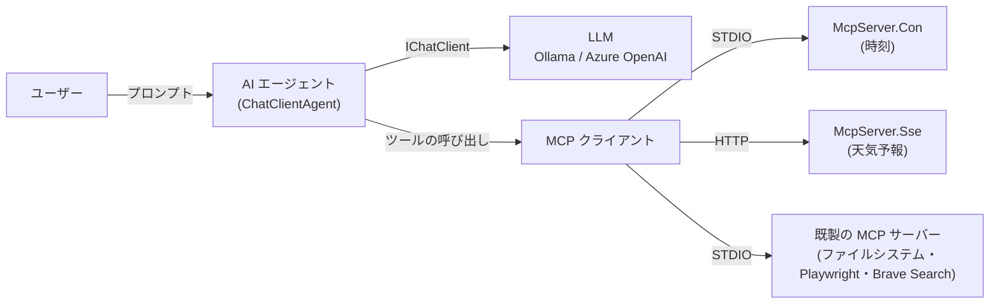

# Shos.AIAgentSample

[](https://opensource.org/licenses/MIT)
[](https://dotnet.microsoft.com/)
[](https://docs.microsoft.com/dotnet/csharp/)

**日本語** | [English](./README.en.md)

**C# / .NET で AI エージェントを作る方法を、ゼロから段階的に学べるハンズオン教材です。**

「AIエージェント開発ハンズオンセミナー (開発者向け)」のサンプルコードと、日本語のチュートリアルをまとめています。**Microsoft Agent Framework** で AI エージェントを作り、**Model Context Protocol (MCP)** で外部のツールを使えるようにするまでを、1 ステップずつ動かしながら学べます。

**リポジトリ**: https://github.com/Fujiwo/Shos.AIAgentSample

## 目次

- [このリポジトリについて](#このリポジトリについて)
- [本リポジトリのポイント](#本リポジトリのポイント)
- [全体像](#全体像)
- [プロジェクト一覧](#プロジェクト一覧)
- [手順書](#手順書)
  - [手順 1 必要なものをそろえる](#手順-1-必要なものをそろえる)
  - [手順 2 リポジトリを取得してビルドする](#手順-2-リポジトリを取得してビルドする)
  - [手順 3 LLM を準備する](#手順-3-llm-を準備する)
  - [手順 4 コードの設定を自分の環境に合わせる](#手順-4-コードの設定を自分の環境に合わせる)
  - [手順 5 コンソールの AI エージェントを動かす](#手順-5-コンソールの-ai-エージェントを動かす)
  - [手順 6 MCP サーバーを動かして確かめる](#手順-6-mcp-サーバーを動かして確かめる)
  - [手順 7 MCP サーバーのツールを AI エージェントから使う](#手順-7-mcp-サーバーのツールを-ai-エージェントから使う)
  - [手順 8 Web チャットを動かす](#手順-8-web-チャットを動かす)
  - [手順 9 CAD アプリを動かす](#手順-9-cad-アプリを動かす)
  - [手順 10 後片付け](#手順-10-後片付け)
- [チュートリアルで自分で作る](#チュートリアルで自分で作る)
- [ファイル構成](#ファイル構成)
- [技術スタック](#技術スタック)
- [用語集](#用語集)
- [トラブルシューティング](#トラブルシューティング)
- [注意事項](#注意事項)
- [ライセンス](#ライセンス)
- [作者](#作者)
- [謝辞](#謝辞)
- [貢献](#貢献)

## このリポジトリについて

このリポジトリでは、次のことを順に学べます。

| 学べること | 内容 | 対応するプロジェクト |
|---|---|---|
| **AI エージェントの基本** | LLM に質問して答えを受け取る、最小の AI エージェントを作る | FCAIAgent1 |
| **LLM の切り替え** | ローカルの Ollama と、クラウドの Azure OpenAI を切り替えて使う | FCAIAgent2 |
| **会話の継続** | 前の発言を覚えたまま、何往復も会話する | FCAIAgent3 |
| **MCP サーバーを作る** | AI エージェントに道具 (ツール) を提供するサーバーを、STDIO と HTTP の 2 方式で作る | McpServer.Con / McpServer.Sse |
| **MCP サーバーのツールを使う** | 自作のサーバーと既製のサーバーのツールを、AI エージェントから使う | FCAIAgent4 / FCAIAgent5 |
| **アプリに組み込む** | AI エージェントを Web チャットやデスクトップアプリに組み込む | FCAIChat1〜5 / FCAICad1 |

> [!IMPORTANT]
> Microsoft Agent Framework と MCP の SDK は、バージョンが上がると API が変わることがあります。このリポジトリは `Microsoft.Agents.AI` 1.28.0 と `ModelContextProtocol` 2.4.0 で動作を確認しています (チュートリアルの執筆当初はプレビュー版を基にしていました)。

## 本リポジトリのポイント

### 1. 前のステップとの「差分」が一目で分かる

FCAIAgent1〜5 と FCAIChat1〜5 は、前のステップのコードに少しずつ機能を足していく構成です。どこを変えたかがすぐ分かるように、コードに **`旧` / `新` の印**を付けています。

```csharp
// 旧: using IChatClient chatClient = GetOllamaClient();
// 新: ここから
// 使用するチャットクライアント種別
const My.ChatClientType chatClientType = My.ChatClientType.AzureOpenAI;
using IChatClient       chatClient     = My.GetChatClient(chatClientType);
// 新: ここまで
```

- `// 新: ここから` 〜 `// 新: ここまで` が、このステップで追加・変更したコードです。
- `// 旧:` の後ろのコメントは、前のステップのコードです (このステップでは使いません)。
- 印は直前のステップからの差分にだけ付いています。前のステップの印は、次のステップでは外しています。

完成形だけを読みたいときは、FCAIAgent5 から印を取り除いた **FCAIAgent** を見てください。

### 2. ローカルとクラウドの LLM を同じコードで使える

`IChatClient` という共通のインターフェイスを通して LLM を使うので、**Ollama** (ローカル、または Ollama のクラウドモデル) と **Azure OpenAI** を、1 行の切り替えで使い分けられます。

### 3. MCP を「作る側」と「使う側」の両方から学べる

- **作る側**: 時刻を返す STDIO のサーバー (McpServer.Con) と、天気予報を返す HTTP のサーバー (McpServer.Sse) を自作します。
- **使う側**: 自作のサーバーに加えて、既製のサーバー (ファイルシステム・Playwright・Brave Search) のツールも AI エージェントから使います。

### 4. コンソール・Web・デスクトップの 3 種類のアプリで試せる

| 種類 | プロジェクト | 何ができるか |
|---|---|---|
| コンソール | FCAIAgent1〜5 | ターミナルで AI エージェントと会話する |
| Web | FCAIChat1〜5 | 複数人のチャットに AI エージェントが参加する (`@Agent` で呼びかける) |
| デスクトップ | FCAICad1 | 「海辺の夕焼けを描いて」のように、言葉で指示すると AI がイラストを描く |

### 5. 最新の C# と、丁寧な日本語のコメント

- C# 14 / .NET 10 の書き方 (プライマリコンストラクター、コレクション式、拡張ブロック、`field` キーワードなど) を使っています。
- ソースコードには、初めて読む人にも分かるように日本語のコメントを付けています。
- 自分で定義した型・定数・メソッドは `static class My` にまとめています。`My.` が付いていれば自作のもの、付いていなければライブラリのもの、と見分けられます。

## 全体像

AI エージェントは、LLM (考える役) とツール (手を動かす役) を組み合わせて動きます。



1. ユーザーがプロンプト (質問や指示) を送ります。
2. AI エージェントは LLM に、使えるツールの一覧と一緒にプロンプトを渡します。
3. LLM がツールを使うと判断したら、AI エージェントが MCP 経由でツールを呼び出し、結果を LLM に返します。
4. LLM がツールの結果を基に答えをまとめ、ユーザーに返します。

## プロジェクト一覧

### コンソールの AI エージェント (FCAIAgent シリーズ)

| プロジェクト | ステップ | できること | チュートリアル |
|---|---|---|---|
| **FCAIAgent1** | 1 | Ollama に 1 回だけ質問して、答えを表示する | [1.1](./Documents/tutorial.1.1.md) |
| **FCAIAgent2** | 2 | Ollama と Azure OpenAI を切り替えて使う (`ChatClientType`) | [1.2](./Documents/tutorial.1.2.md) |
| **FCAIAgent3** | 3 | `AgentSession` で会話を覚えたまま、何往復も会話する | [1.3](./Documents/tutorial.1.3.md) |
| **FCAIAgent4** | 4 | STDIO の MCP サーバー (McpServer.Con) の時刻ツールを使う | [3.1](./Documents/tutorial.3.1.md) |
| **FCAIAgent5** | 5 | 複数の MCP サーバー (時刻・天気予報・ファイルシステム) のツールを使う | [3.2](./Documents/tutorial.3.2.md) |
| **FCAIAgent** | 完成形 | FCAIAgent5 と同じコードから、`旧` / `新` の印を取り除いたもの | — |

### MCP サーバー

| プロジェクト | 通信方式 | 提供するツール | チュートリアル |
|---|---|---|---|
| **McpServer.Con** | STDIO (標準入出力) | `GetCurrentTime` (現在時刻)、`GetTimeInTimezone` (指定したタイムゾーンの時刻) | [2.1](./Documents/tutorial.2.1.md) |
| **McpServer.Sse** | HTTP (Streamable HTTP)。`http://localhost:3001/` で待ち受ける | `GetWeatherForecast` (都道府県の天気予報。北海道・東京都・石川県・福井県だけ固定の値を返す学習用のデータ) | [2.2](./Documents/tutorial.2.2.md) |

> [!NOTE]
> McpServer.Sse は名前に「Sse」と付いていますが、通信方式は現行の Streamable HTTP です。旧来の SSE 用のエンドポイント (`/sse`) は既定で無効です。

### Web チャット (FCAIChat シリーズ)

ASP.NET Core Razor Pages と SignalR でチャットアプリを作り、最後に AI エージェントを参加させます。ステップ 1〜3 はチャットアプリそのものを作る段階で、LLM は使いません。

| プロジェクト | ステップ | できること |
|---|---|---|
| **FCAIChat1** | 1 | SignalR によるリアルタイムチャット。ASP.NET Core Identity によるログイン |
| **FCAIChat2** | 2 | メッセージをデータベース (EF Core + SQL Server LocalDB) に保存し、ページを開いたときに過去のメッセージを表示する |
| **FCAIChat3** | 3 | 部分ビュー (`_MessagePartial`) で、メッセージを吹き出しの形で表示する |
| **FCAIChat4** | 4 | AI エージェント (Azure OpenAI) がチャットに参加する。`@Agent` を含むメッセージに答える。Playwright MCP サーバーでブラウザーを操作できる |
| **FCAIChat5** | 5 | Brave Search MCP サーバーで Web を検索できる。ログインしたユーザーごとに会話を保存・復元する。会話をクリアできる |

### CAD アプリ (FCAICad1)

Windows Forms のお絵描き (CAD) アプリです。「森の中の小さな家を描いて」のように言葉で指示すると、AI エージェントが描画ツールを何度も呼び出してイラストを描きます。AI エージェントを**デスクトップアプリに組み込み、言葉でアプリを操作する**例になっています。

AI エージェントには、`Toolbox.cs` の静的メソッドを `AIFunctionFactory.Create` でツールとして渡しています。

| ツール | 内容 |
|---|---|
| `GetPaperSize` | 用紙のサイズ (幅 3000・高さ 2000) を返す |
| `GetAvailableColors` | 使える色の名前の一覧を返す |
| `ClearAll` | すべての図形を消す |
| `DrawLine` | 直線を描く |
| `DrawRectangle` / `DrawRoundedRectangle` | 矩形 / 角丸矩形を描く |
| `DrawCircle` / `DrawEllipse` | 円 / 楕円を描く |
| `DrawPolylineOrPolygon` | 折れ線 / 多角形を描く |
| `DrawCurve` / `DrawFreeFormCurve` | 点を滑らかにつなぐ曲線 / 自由曲線を描く |

AI エージェントへの指示 (システムプロンプト) と、ツールの説明 (`[Description]`) には、イラストをきれいに描くためのコツ (構図・配色・重ね順・部品の描き方など) を書いています。プロンプトの書き方で結果がどう変わるかを試す教材としても使えます。環境変数 `BRAVE_API_KEY` を設定すると、Brave Search のツールで Web も検索できます (設定しなくても描画はできます)。

## 手順書

ここからは、このリポジトリのサンプルを**実際に動かすまでの手順**を順に説明します。Windows 11 と Visual Studio 2026 を使う前提で書いています。macOS / Linux でのやり方も、違うところだけ書いています。

全体の流れは次のとおりです。

| 手順 | やること | 所要時間の目安 | 必須かどうか |
|---|---|---|---|
| 1 | 必要なソフトウェアをインストールする | 30〜60 分 | 必須 |
| 2 | リポジトリを取得してビルドする | 5 分 | 必須 |
| 3 | LLM (Ollama か Azure OpenAI) を準備する | 10〜30 分 | 必須 (どちらか一方) |
| 4 | コードの設定を自分の環境に合わせる | 10 分 | 必須 |
| 5 | コンソールの AI エージェントを動かす | 15 分 | 必須 |
| 6 | MCP サーバーを動かして確かめる | 15 分 | 推奨 |
| 7 | MCP サーバーのツールを AI エージェントから使う | 15 分 | 必須 |
| 8 | Web チャットを動かす | 30 分 | 任意 |
| 9 | CAD アプリを動かす | 10 分 | 任意 |
| 10 | 後片付け | 5 分 | Azure を使った場合は必須 |

### 手順 1 必要なものをそろえる

#### 1-1. ソフトウェアをインストールする

| ソフトウェア | バージョン | 何に使うか | 入手先 |
|---|---|---|---|
| **.NET SDK** | 10.0 以上 (必須) | ビルドと実行。すべてのプロジェクトが .NET 10 向けなので、10.0 未満ではビルドできない | [.NET のダウンロード](https://dotnet.microsoft.com/download) |
| **Visual Studio 2026** (または VS Code) | .NET 10 に対応したもの | コードの編集と実行。Visual Studio では「ASP.NET と Web 開発」と「.NET デスクトップ開発」のワークロードを選ぶ | [Visual Studio](https://visualstudio.microsoft.com/ja/) |
| **Node.js** | v24 以上を推奨 | 既製の MCP サーバーの起動 (`npx`) | [Node.js](https://nodejs.org/ja/download) |
| **Git** | 最新版 | リポジトリの取得 | [Git](https://git-scm.com/) |
| **Ollama** | 最新版 | ローカルや Ollama のクラウドで LLM を動かす (Azure OpenAI だけを使う場合は不要) | [Ollama](https://ollama.com/) |

画面の画像付きのインストール手順は、[0.1 インストール](./Documents/tutorial.0.1.md) にあります。

#### 1-2. インストールできたか確かめる

ターミナル (Windows では「ターミナル」や PowerShell) で、次のコマンドを実行します。

```console
dotnet --version
node -v
npx -v
git --version
ollama --version
```

`dotnet --version` が `10.0.` で始まる番号を表示すれば OK です。ほかのコマンドも、バージョン番号が表示されれば OK です。

#### 1-3. (任意) 使うものに応じて用意するもの

| 使いたいもの | 必要なもの |
|---|---|
| Azure OpenAI | Azure のアカウントと、Azure OpenAI のリソース (手順 3 で作る) |
| FCAIChat5 と FCAICad1 の Web 検索 | Brave Search API の API キー ([Brave Search API](https://brave.com/search/api/) で取得) |
| FCAIChat1〜5 | SQL Server LocalDB (Visual Studio の「ASP.NET と Web 開発」ワークロードに含まれる) と、EF Core のコマンドラインツール (手順 8 で入れる) |

#### 1-4. (推奨) セミナー資料を読む

AI エージェント・LLM・MCP の考え方は、セミナー資料で先に押さえておくと理解が速くなります。

- [2025010.AIエージェント開発ハンズオンセミナー.pdf](./Documents/2025010.AIエージェント開発ハンズオンセミナー.pdf)
- [20251220.AIエージェント開発ハンズオンセミナー.pdf](./Documents/20251220.AIエージェント開発ハンズオンセミナー.pdf)

### 手順 2 リポジトリを取得してビルドする

#### 2-1. リポジトリを取得する

```console
git clone https://github.com/Fujiwo/Shos.AIAgentSample.git
cd Shos.AIAgentSample
```

> [!TIP]
> サンプルのコードは、リポジトリを `C:\Source\FCAIAgentSample` に置いた前提で書かれている箇所があります (手順 4 で説明します)。このフォルダーに取得すると、パスを書き換える手間が減ります。
>
> ```console
> git clone https://github.com/Fujiwo/Shos.AIAgentSample.git C:\Source\FCAIAgentSample
> ```

#### 2-2. ビルドする

**Visual Studio の場合**: `Shos.AIAgentSample.sln` を開き、メニューの「ビルド」→「ソリューションのビルド」を選びます。

**コマンドの場合**:

```console
dotnet build Shos.AIAgentSample.sln
```

最後に `ビルドに成功しました。` (英語の環境では `Build succeeded.`) と表示されれば OK です。

> [!NOTE]
> macOS / Linux では、Windows 専用の FCAICad1 がビルドできないため、ソリューション全体のビルドは失敗します。`dotnet build FCAIAgent5` のように、プロジェクトごとにビルドしてください。

### 手順 3 LLM を準備する

**A (Ollama)** と **B (Azure OpenAI)** のどちらか一方を準備します。両方を準備しておくと、すべてのサンプルを試せます。

| | A. Ollama | B. Azure OpenAI |
|---|---|---|
| 費用 | 無料枠あり | 使った分だけ課金される |
| 必要なもの | Ollama と Ollama のアカウント | Azure のアカウント |
| 使えるサンプル | FCAIAgent1〜5、FCAIAgent、FCAICad1 | FCAIAgent2〜5、FCAIAgent、FCAIChat4 / 5、FCAICad1 |

#### A. Ollama を準備する

1. Ollama を起動し、Ollama のアカウントでサインインします。

   ```console
   ollama signin
   ```

2. サンプルが既定で使うクラウドモデル `minimax-m3:cloud` を試します。返事が返ってくれば OK です (`/bye` で終了します)。

   ```console
   ollama run minimax-m3:cloud
   ```

3. Ollama が `http://localhost:11434` で動いていることを確かめます。ブラウザーでこの URL を開き、`Ollama is running` と表示されれば OK です。

> [!TIP]
> **インターネットにつながないローカルの LLM を使う場合**は、`ollama pull gemma3` などでモデルをダウンロードし、コードの `ollama.SelectedModel = "minimax-m3:cloud";` をそのモデル名に変えてください。ただし、小さいモデルはツールの呼び出しが苦手なことがあります。

#### B. Azure OpenAI を準備する

1. [0.2 Azure OpenAI](./Documents/tutorial.0.2.md) の手順で、Azure OpenAI のリソースを作り、モデルをデプロイします。
   - デプロイ名は、コードの `deploymentName` と同じ **`MAI-Thinking-1`** にします。別の名前にした場合は、手順 4 でコードの `deploymentName` も変えてください。
2. Azure AI Foundry ポータルで、**エンドポイント**と **API キー**をコピーしておきます。
3. 環境変数を設定します。サンプルは、エンドポイントと API キーを環境変数から読み込みます。

   **Windows (コマンド プロンプト / PowerShell)**: 設定は次に開くターミナルや Visual Studio から有効になります。

   ```console
   setx AZURE_OPENAI_ENDPOINT "https://<リソース名>.openai.azure.com/"
   setx AZURE_OPENAI_API_KEY "<API キー>"
   ```

   **macOS / Linux**: `~/.bashrc` や `~/.zshrc` に書いておくと、毎回入力しなくて済みます。

   ```bash
   export AZURE_OPENAI_ENDPOINT="https://<リソース名>.openai.azure.com/"
   export AZURE_OPENAI_API_KEY="<API キー>"
   ```

4. **設定したら、ターミナルと Visual Studio をいったん閉じて開き直します。** 開いたままだと、新しい環境変数が読み込まれません。

> [!CAUTION]
> API キーはパスワードと同じです。ソースコードに直接書いたり、Git にコミットしたりしないでください。

#### 環境変数の一覧

| 環境変数 | 必須かどうか | 使うプロジェクト | 内容 |
|---|---|---|---|
| `AZURE_OPENAI_ENDPOINT` | Azure OpenAI を使う場合は必須 | FCAIAgent2〜5、FCAIAgent、FCAIChat4 / 5、FCAICad1 | Azure OpenAI のエンドポイント |
| `AZURE_OPENAI_API_KEY` | Azure OpenAI を使う場合は必須 | 同上 | Azure OpenAI の API キー |
| `BRAVE_API_KEY` | FCAIChat5 では必須、FCAICad1 では任意 | FCAIChat5、FCAICad1 | Brave Search API の API キー |
| `WEATHER_MCP_ENDPOINT` | 任意 | FCAIAgent5、FCAIAgent | McpServer.Sse の URL。設定しない場合は `http://localhost:3001/` |

### 手順 4 コードの設定を自分の環境に合わせる

サンプルには、環境によって書き換えが必要な設定があります。**使うプロジェクトの分だけ**直してください。

| 設定 | 場所 | 既定値 | いつ変えるか |
|---|---|---|---|
| **使う LLM の種類** | FCAIAgent2〜5、FCAIAgent の `Program.cs` の `chatClientType` | `My.ChatClientType.AzureOpenAI` | **Ollama を使うときは `My.ChatClientType.Ollama` に変える** |
| Ollama のモデル名 | 各プロジェクトの `ollama.SelectedModel` | `"minimax-m3:cloud"` | 別のモデルを使うとき |
| Azure OpenAI のデプロイ名 | 各プロジェクトの `deploymentName` | `"MAI-Thinking-1"` | 別のデプロイ名にしたとき |
| **McpServer.Con のパス** | FCAIAgent4 / 5、FCAIAgent の `Program.cs` の `Arguments` | `C:\Source\FCAIAgentSample\McpServer.Con\McpServer.Con.csproj` | **リポジトリを別の場所に置いたとき (必ず変える)** |
| ファイルシステム ツールのフォルダー | FCAIAgent5、FCAIAgent の `Program.cs` の `"/work"` | `/work` (Windows では `C:\work`) | 別のフォルダーを使うとき。**フォルダーは事前に作っておく** |
| FCAICad1 の LLM | `FCAICad1/ChatAgent.cs` の先頭の `#define AZURE_OPENAI` | Azure OpenAI | Ollama を使うときは、この行を `//#define AZURE_OPENAI` にする |
| MCP クライアントの設定 | `.mcp.json`、`.vscode/mcp.json` | McpServer.Con のパスは上と同じ | Visual Studio / VS Code から McpServer.Con を使うとき |

例として、リポジトリを `D:\Work\Shos.AIAgentSample` に置いた場合は、FCAIAgent4 の `Program.cs` を次のように直します。

```csharp
Arguments = ["run", "--project", @"D:\Work\Shos.AIAgentSample\McpServer.Con\McpServer.Con.csproj"]
```

### 手順 5 コンソールの AI エージェントを動かす

#### 実行のしかた

**Visual Studio の場合**:

1. ソリューション エクスプローラーで、動かしたいプロジェクト (例: `FCAIAgent1`) を右クリックします。
2. 「スタートアップ プロジェクトに設定」を選びます。
3. F5 キー (デバッグ実行) か Ctrl+F5 キー (デバッグなしで実行) を押します。

**コマンドの場合** (リポジトリのフォルダーで実行):

```console
dotnet run --project FCAIAgent1
```

#### 5-1. FCAIAgent1: 1 回だけ質問する (Ollama)

FCAIAgent1 を実行すると、コードに書かれた質問「「AIエージェント」とはどのようなものですか?」を Ollama に送り、答えを表示して終了します。答えの文章が表示されれば成功です。

#### 5-2. FCAIAgent2: LLM を切り替える

FCAIAgent2 の `chatClientType` を `AzureOpenAI` か `Ollama` にして実行し、同じ質問への答えを比べてみてください。

#### 5-3. FCAIAgent3: 会話を続ける

FCAIAgent3 を実行すると、会話の画面になります。

```console
(Interactive chat started. Type 'exit' to quit.)

You: 私の名前は太郎です
Agent: ...
You: 私の名前を覚えていますか?
Agent: はい、太郎さんですね。...
You: exit
```

2 回目の質問に正しく答えられれば、会話の内容を覚えている (`AgentSession` が働いている) ことが分かります。`exit` か空行を入力すると終了します。

### 手順 6 MCP サーバーを動かして確かめる

#### 6-1. McpServer.Sse (HTTP) を起動する

```console
dotnet run --project McpServer.Sse
```

`http://localhost:3001` で待ち受けを始めます。このターミナルは、手順 7 が終わるまで**閉じずにそのまま**にしておきます。

#### 6-2. GitHub Copilot からツールを呼び出してみる

AI エージェントから使う前に、MCP サーバーが正しく動くかを、Visual Studio や VS Code の GitHub Copilot (エージェント モード) で確かめます。

1. MCP サーバーの設定ファイルを開き、McpServer.Con のパスを自分の環境に合わせます (手順 4)。
   - VS Code: `.vscode/mcp.json`
   - Visual Studio: `.mcp.json`
2. McpServer.Sse を起動したままにしておきます (手順 6-1)。
3. GitHub Copilot のチャットをエージェント モードで開き、ツールの一覧に `McpServer.Con` と `McpServer.Sse` のツールがあるか確かめます。
4. 「今何時?」「東京都の天気は?」と質問し、ツールが呼び出されて答えが返れば OK です。

詳しい手順と画面は、[2.3 MCP サーバーの動作確認](./Documents/tutorial.2.3.md) にあります。

> [!TIP]
> GitHub Copilot を使わない場合は、MCP Inspector (`npx @modelcontextprotocol/inspector`) でも確かめられます。ブラウザーに開く画面で、McpServer.Sse には Streamable HTTP で `http://localhost:3001/` に、McpServer.Con には STDIO でコマンド `dotnet`・引数 `run --project <McpServer.Con.csproj のフルパス>` で接続し、ツールを呼び出します。

> [!NOTE]
> McpServer.Con は、AI エージェントや GitHub Copilot などの MCP クライアントが子プロセスとして起動するサーバーです。自分で `dotnet run` して使うものではありません。

### 手順 7 MCP サーバーのツールを AI エージェントから使う

#### 7-1. FCAIAgent4: 時刻ツールを使う

手順 4 で McpServer.Con のパスを直してから、FCAIAgent4 を実行します。

```console
You: 今何時ですか?
Agent: 現在の時刻は ... です。
You: ニューヨークは今何時?
```

LLM は時刻を知りませんが、McpServer.Con の時刻ツールを呼び出して正しい時刻を答えます。

#### 7-2. FCAIAgent5: 複数の MCP サーバーのツールを使う

1. ファイルシステム ツール用のフォルダー `C:\work` を作り、何かテキストファイルを入れておきます。
2. McpServer.Sse を起動したままにしておきます (手順 6-1)。
3. FCAIAgent5 を実行して、次のように質問します。

```console
You: 東京都の天気を教えて          ← McpServer.Sse の天気予報ツール
You: 今の時刻を教えて              ← McpServer.Con の時刻ツール
You: work フォルダーのファイルを一覧にして   ← ファイルシステム ツール
```

1 つの AI エージェントが、質問に合わせて複数のサーバーのツールを使い分けることを確かめてください。

### 手順 8 Web チャットを動かす

FCAIChat1〜5 は Windows で動かす前提です (データベースに SQL Server LocalDB を使うため)。

#### 8-1. EF Core のツールを入れる (最初の 1 回だけ)

```console
dotnet tool install --global dotnet-ef
```

#### 8-2. データベースを作る

FCAIChat1〜5 は、同じデータベース名を使います。動かすプロジェクトのフォルダーで、次のコマンドを実行します。

**FCAIChat1 の場合**:

```console
cd FCAIChat1
dotnet ef database update
```

**FCAIChat2〜5 の場合** (データベースの設定が 2 つあるので、それぞれ実行します):

```console
cd FCAIChat2
dotnet ef database update --context ApplicationDbContext
dotnet ef database update --context MessagesDbContext
```

> [!WARNING]
> FCAIChat1 と FCAIChat2〜5 では、ユーザー情報のテーブルを作るマイグレーションが違います。FCAIChat1 の後に FCAIChat2〜5 を動かすときに `There is already an object named 'AspNetRoles'` のようなエラーが出たら、次のコマンドでデータベースを削除してから作り直してください (登録したユーザーとメッセージは消えます)。
>
> ```console
> dotnet ef database drop --context ApplicationDbContext --force
> ```

Visual Studio のパッケージ マネージャー コンソールを使う場合は、`Update-Database -Context ApplicationDbContext` のように実行します。

#### 8-3. 起動してログインする

1. プロジェクトを実行します (例: `dotnet run --project FCAIChat5`)。Visual Studio から実行すると、ブラウザーが自動で開きます。
2. ブラウザーで `https://localhost:7274` (または `http://localhost:5138`) を開きます。
3. 画面右上の「Register」から、メールアドレスとパスワードを登録します。
4. 「Click here to confirm your account」のリンクを押して、アカウントを確認済みにします (メールは送られません)。
5. 「Login」からログインします。
6. 別のブラウザー (またはシークレット ウィンドウ) で別のユーザーとしてログインすると、メッセージがリアルタイムに届くことを確かめられます。

#### 8-4. AI エージェントと会話する (FCAIChat4 / 5)

- 環境変数 `AZURE_OPENAI_ENDPOINT` と `AZURE_OPENAI_API_KEY` が必要です。FCAIChat5 は `BRAVE_API_KEY` も必要です。
- メッセージに **`@Agent`** を入れると、AI エージェントが答えます (入れないと、人どうしのメッセージとして扱われます)。

```text
@Agent https://github.com を開いて、ページのタイトルを教えて      ← FCAIChat4 (Playwright)
@Agent .NET 10 の新機能を検索して、3 つにまとめて              ← FCAIChat5 (Brave Search)
```

- FCAIChat5 では、ページを開き直しても、ログインしたユーザーごとに会話の続きができます。クリア ボタンで会話を最初からやり直せます。

### 手順 9 CAD アプリを動かす

FCAICad1 は Windows 専用です。

1. 使う LLM を決めます。既定は Azure OpenAI です (環境変数 `AZURE_OPENAI_ENDPOINT` と `AZURE_OPENAI_API_KEY` が必要)。Ollama を使う場合は、手順 4 のとおり `#define AZURE_OPENAI` をコメントにします。
2. `FCAICad1` をスタートアップ プロジェクトにして実行します。
3. 画面の下の入力欄に指示を書き、🤖 ボタンを押します。AI が考えている間は、ボタンの絵文字が切り替わります。

   ```text
   青空の下の草原に、赤い屋根の家と大きな木を描いて
   夜の海に浮かぶ満月と、ヨットを描いて
   左の木にリンゴを 3 つ描き足して
   ```

4. 描き終わると、入力欄の下の応答欄に AI の説明が表示されます。

| 操作 | 内容 |
|---|---|
| 🆑 ボタン | 図形をすべて消す |
| Ctrl+C | 描いた絵を画像としてクリップボードにコピーする |

> [!TIP]
> 指示に「絵本のような」「シンプルなアイコン風に」などの画風や、「左下に」「大きく」などの位置や大きさを書くと、思いどおりの絵に近づきます。続けて「〜を描き足して」と頼むと、前の絵に描き足します。

### 手順 10 後片付け

- **Azure OpenAI を使った場合**: 使わなくなったら、[Azure Portal](https://portal.azure.com) でリソース グループごと削除します (削除しないと課金が続くことがあります)。詳しくは [4.1 後片付け](./Documents/tutorial.4.1.md) を見てください。
- **環境変数**: 不要になったら削除します (Windows では「システムの詳細設定」→「環境変数」から削除できます)。
- **データベース**: FCAIChat のデータベースが不要なら、`dotnet ef database drop --context ApplicationDbContext --force` で削除します。

## チュートリアルで自分で作る

サンプルを動かすだけでなく、**自分でコードを書きながら**学ぶこともできます。各チュートリアルには、作るコードの全体、実行結果、画面の画像が載っています。

1. [チュートリアルのトップ](./Documents/tutorial.md) を開きます。
2. 新しいコンソール アプリのプロジェクトを作り、チュートリアルのコードを書きます。
3. 次のステップでは、コードの `旧` の部分を `新` の部分に書き換えます。
4. うまく動かないときは、同じステップのサンプル (FCAIAgent1〜5) と見比べます。

| 章 | チュートリアル | 作るもの | 所要時間の目安 |
|---|---|---|---|
| 0. 準備 | [0.1 インストール](./Documents/tutorial.0.1.md) / [0.2 Azure OpenAI](./Documents/tutorial.0.2.md) | 開発環境と LLM | 30〜60 分 |
| 1. AI エージェントの作成 | [1.1 ローカル LLM の利用](./Documents/tutorial.1.1.md) / [1.2 Azure OpenAI の利用](./Documents/tutorial.1.2.md) / [1.3 複数ターンのチャット](./Documents/tutorial.1.3.md) | FCAIAgent1〜3 | 1〜2 時間 |
| 2. MCP サーバーの作成 | [2.1 STDIO](./Documents/tutorial.2.1.md) / [2.2 HTTP](./Documents/tutorial.2.2.md) / [2.3 動作確認](./Documents/tutorial.2.3.md) | McpServer.Con / McpServer.Sse | 1〜2 時間 |
| 3. MCP サーバーの利用 | [3.1 単数](./Documents/tutorial.3.1.md) / [3.2 複数](./Documents/tutorial.3.2.md) | FCAIAgent4 / 5 | 1〜2 時間 |
| 4. 後片付け | [4.1 後片付け](./Documents/tutorial.4.1.md) | — | 5 分 |

学習のコツ:

- **順番に進めてください。** 各ステップは、前のステップの内容を前提にしています。
- **コピーして終わりにせず、コードの意味を考えながら進めてください。** コードのコメントが理解の助けになります。
- **コードを変えて試してください。** エージェントへの指示 (`Instructions`) や質問を変えると、答えがどう変わるかが分かります。
- **エラーも学びの一部です。** エラーメッセージを読み、[トラブルシューティング](#トラブルシューティング) を参考に直してみてください。

## ファイル構成

```text
Shos.AIAgentSample/
├── README.md                   このファイル (日本語)
├── README.en.md                README (英語)
├── CLAUDE.md                   AI コーディング エージェント向けの説明
├── LICENSE.txt                 ライセンス (MIT License)
├── Shos.AIAgentSample.sln      Visual Studio のソリューション
├── .mcp.json                   MCP サーバーの設定の例
├── .vscode/mcp.json            VS Code 用の MCP サーバーの設定の例
├── .github/                    GitHub Copilot 向けの説明 (copilot-instructions.md)
│
├── Documents/                  チュートリアルとセミナー資料
│   ├── tutorial.md             チュートリアルのトップ
│   ├── tutorial.0.1.md 〜 tutorial.4.1.md   各章のチュートリアル
│   ├── maf.md                  Microsoft Agent Framework の補足
│   ├── aiagentlog.md           AI エージェントの実行ログの例
│   ├── *.pdf                   セミナー資料
│   └── Images/                 チュートリアルの画像
│
├── FCAIAgent1/ 〜 FCAIAgent5/  コンソールの AI エージェント (ステップ 1〜5。Program.cs 1 ファイル)
├── FCAIAgent/                  コンソールの AI エージェントの完成形
│
├── McpServer.Con/              STDIO の MCP サーバー (時刻ツール)
├── McpServer.Sse/              HTTP の MCP サーバー (天気予報ツール)
│
├── FCAIChat1/ 〜 FCAIChat5/    Web チャット (ステップ 1〜5)
│   ├── Pages/                  Razor Pages
│   ├── Hubs/ChatHub.cs         SignalR のハブ (メッセージの配信と保存、AI エージェントへの転送)
│   ├── Data/                   EF Core の DbContext
│   ├── AIAgents/               AI エージェント (FCAIChat4 / 5)
│   ├── Services/               会話の保存 (FCAIChat5)
│   └── wwwroot/                CSS・JavaScript などの静的ファイル
│
├── FCAICad1/                   CAD アプリ (Windows Forms)
│   ├── Program.cs              起動処理 (フォームと AI エージェントをつなぐ)
│   ├── ChatAgent.cs            AI エージェント (システムプロンプト、LLM、ツール)
│   ├── Toolbox.cs              AI エージェントに渡す描画ツール
│   ├── MainForm.cs / View.cs   画面
│   └── Model.cs                図形のデータと描画
│
├── Plans/                      修正計画
└── Reviews/                    コードとドキュメントのレビュー結果
```

## 技術スタック

| 分類 | 内容 |
|---|---|
| 言語 | C# 14 |
| ランタイム | .NET 10 (FCAICad1 は `net10.0-windows`) |
| AI エージェント | `Microsoft.Agents.AI` / `Microsoft.Agents.AI.OpenAI` 1.28.0、`Microsoft.Extensions.AI` |
| MCP | `ModelContextProtocol` / `ModelContextProtocol.AspNetCore` 2.4.0 |
| LLM との接続 | `OllamaSharp` 5.5.2 (Ollama)、`Azure.AI.OpenAI` 2.1.0 (Azure OpenAI) |
| Web | ASP.NET Core Razor Pages、SignalR、ASP.NET Core Identity、EF Core 10 (SQL Server LocalDB) |
| デスクトップ | Windows Forms |
| 既製の MCP サーバー | `@modelcontextprotocol/server-filesystem`、`@playwright/mcp`、`@modelcontextprotocol/server-brave-search` |

| OS | 動くプロジェクト |
|---|---|
| Windows 11 / 10 | すべて |
| macOS / Linux | FCAIAgent シリーズと MCP サーバー。FCAIChat シリーズは `appsettings.json` の接続文字列を LocalDB 以外の SQL Server などに変えれば動く。FCAICad1 は動かない |

## 用語集

| 用語 | 意味 |
|---|---|
| **LLM** (大規模言語モデル) | 文章を理解し、文章を作る AI のモデル。GPT など |
| **AI エージェント** | LLM で考え、必要に応じてツールを使いながら、頼まれた仕事を自分で進めるプログラム |
| **Microsoft Agent Framework** | Microsoft の AI エージェント開発用のフレームワーク。`ChatClientAgent` や `AgentSession` を提供する |
| **IChatClient** | .NET で LLM とやり取りするための共通のインターフェイス (`Microsoft.Extensions.AI`)。LLM の種類を問わず同じ書き方で使える |
| **AgentSession** | 会話の履歴などを保持するオブジェクト。これを使うと、前の発言を覚えたまま会話できる |
| **ツール** (関数呼び出し) | AI エージェントが使える関数。LLM が「この関数をこの引数で呼んで」と判断し、エージェントが実行する |
| **MCP** (Model Context Protocol) | AI エージェントとツールをつなぐ標準の通信規約。一度 MCP サーバーを作れば、MCP に対応したどの AI エージェントからも使える |
| **MCP サーバー / MCP クライアント** | ツールを提供する側 / ツールを使う側 |
| **STDIO** | 標準入出力。MCP クライアントが MCP サーバーを子プロセスとして起動し、標準入出力でやり取りする方式 |
| **Streamable HTTP** | MCP の現行の HTTP の通信方式。ネットワーク越しに MCP サーバーを使える |
| **SSE** (Server-Sent Events) | サーバーからクライアントへ一方向にデータを送る仕組み。MCP の旧来の HTTP の通信方式で使われていた |
| **Ollama** | LLM を手元のパソコンや Ollama のクラウドで動かすためのツール |
| **Azure OpenAI** | Microsoft Azure 上で OpenAI などのモデルを使えるクラウドサービス |

## トラブルシューティング

<details>
<summary><strong>ビルドできない</strong></summary>

- `dotnet --version` で、.NET SDK 10.0 以上が入っているか確かめてください。
- パッケージを復元し直してから、ビルドし直してください。

  ```console
  dotnet restore
  dotnet clean
  dotnet build
  ```

- macOS / Linux では、FCAICad1 はビルドできません。プロジェクトごとにビルドしてください。

</details>

<details>
<summary><strong>「Please set the AZURE_OPENAI_ENDPOINT environment variable.」と表示される</strong></summary>

- 環境変数が設定されていません。[手順 3 の B](#b-azure-openai-を準備する) のとおりに設定してください。
- 設定した後に、**ターミナルと Visual Studio を開き直しましたか?** 開いたままだと、新しい環境変数は読み込まれません。
- Ollama を使いたい場合は、`chatClientType` を `My.ChatClientType.Ollama` に変えてください (手順 4)。

</details>

<details>
<summary><strong>Ollama に接続できない</strong></summary>

- Ollama が起動しているか確かめてください (Windows ではタスク トレイに Ollama のアイコンが出ます)。ブラウザーで `http://localhost:11434` を開くと `Ollama is running` と表示されます。
- クラウドモデル (`minimax-m3:cloud`) を使う場合は、`ollama signin` でサインインしてください。
- ローカルの LLM を使う場合は、`ollama list` でモデルがダウンロードされているか確かめ、コードの `SelectedModel` をそのモデル名にしてください。

</details>

<details>
<summary><strong>Azure OpenAI に接続できない (401 / 404 エラー)</strong></summary>

- **401 (認証エラー)**: API キーが間違っています。Azure AI Foundry ポータルからコピーし直してください。
- **404 (見つからない)**: デプロイ名がコードの `deploymentName` と違うか、エンドポイントが間違っています。
- 会社のネットワークでは、ファイアウォールやプロキシの設定も確かめてください。

</details>

<details>
<summary><strong>MCP サーバーにつながらない / ツールが使われない</strong></summary>

- **McpServer.Con**: `Arguments` のパスが、自分の環境の `McpServer.Con.csproj` のフルパスになっているか確かめてください (手順 4)。
- **McpServer.Sse**: 別のターミナルで `dotnet run --project McpServer.Sse` を実行し、起動したままにしているか確かめてください。
- **ファイルシステム ツール**: `C:\work` フォルダーがあるか確かめてください。
- **npx で起動するサーバー**: `npx -v` でバージョンが表示されるか確かめてください。初回はパッケージのダウンロードに時間がかかります。
- **Playwright** (FCAIChat4): ブラウザーが無いというエラーが出たら、`npx playwright install chrome` を実行してください。
- ツールを呼び出すのが苦手な LLM もあります。動かないときは、別のモデルで試してください。

</details>

<details>
<summary><strong>Web チャットが起動しない / ログインできない</strong></summary>

- **データベースのエラー**: 手順 8-2 の `dotnet ef database update` を実行したか確かめてください。
- **`There is already an object named ...`**: 手順 8-2 の注意のとおり、データベースを作り直してください。
- **HTTPS の証明書のエラー**: `dotnet dev-certs https --trust` を実行してください。
- **ポートが使われている**: `Properties/launchSettings.json` でポート番号を変えられます。
- **`@Agent` に答えない**: Azure OpenAI の環境変数 (FCAIChat5 では `BRAVE_API_KEY` も) を設定し、Visual Studio を開き直してください。

</details>

<details>
<summary><strong>CAD アプリが起動しない / 思ったように描けない</strong></summary>

- FCAICad1 は Windows 専用です。Visual Studio に「.NET デスクトップ開発」のワークロードが入っているか確かめてください。
- 応答欄に `(エラー: ...)` と表示される場合は、LLM との接続を確かめてください (Azure OpenAI の環境変数など)。
- 絵が思ったようにならないときは、画風・位置・大きさ・色を具体的に指示してみてください。システムプロンプト (`FCAICad1/ChatAgent.cs`) を自分で書き換えて、結果の違いを試すこともできます。

</details>

解決しないときは、[Issues](https://github.com/Fujiwo/Shos.AIAgentSample/issues) で質問してください。

## 注意事項

> [!WARNING]
> このリポジトリのコードは、学習とチュートリアルのためのものです。

| 項目 | 注意 |
|---|---|
| ライブラリの変更 | Microsoft Agent Framework と MCP の SDK は、バージョンが上がると API が変わることがあります |
| 本番での利用 | 本番で使う前に、セキュリティの確認と、エラー処理・性能の見直しをしてください |
| API キー | API キーなどの秘密の情報は、環境変数や安全な設定管理の仕組みで扱い、コードに書かないでください |
| 費用 | Azure OpenAI や Ollama のクラウドモデルは、使った量に応じて費用や利用制限がかかることがあります |
| AI の操作 | AI エージェントはツールを自分の判断で呼び出します。ファイルシステムやブラウザーを操作するツールでは、アクセスできる範囲を必要最小限にしてください |

## ライセンス

MIT License

Copyright (c) 2025 Fujio Kojima

詳しくは [LICENSE.txt](./LICENSE.txt) を見てください。

## 作者

**小島 富治雄 (Fujio Kojima)** - ソフトウェア開発エンジニア

### 経歴・実績

- **Microsoft MVP for Development Tools - Visual C#** (Jul. 2005 - Dec. 2014)
- **Microsoft MVP for .NET** (Jan. 2015 - Oct. 2015)
- **Microsoft MVP for Visual Studio and Development Technologies** (Nov. 2015 - Jun. 2018)
- **Microsoft MVP for Developer Technologies** (Nov. 2018 - Jun. 2026)

### 連絡先・リンク

- **GitHub**: [@Fujiwo](https://github.com/Fujiwo)
- **MVP Profile**: [Microsoft MVP Profile](https://mvp.microsoft.com/en-us/PublicProfile/21482)
- **ブログ**: [Sho's Digital Cafe](http://wp.shos.info)
- **Web サイト**: [www.shos.info](http://www.shos.info)
- **X (Twitter)**: [@Fujiwo](https://x.com/Fujiwo)
- **Instagram**: [@fujiwo](https://www.instagram.com/fujiwo/)

## 謝辞

このプロジェクトは、次のオープンソースのプロジェクトと技術を使っています。

- **[Microsoft Agent Framework](https://github.com/microsoft/agent-framework)** - AI エージェント開発のフレームワーク
- **[Model Context Protocol (MCP)](https://modelcontextprotocol.io/)** - AI エージェントとツールをつなぐ標準の通信規約
- **[Ollama](https://ollama.com/)** - LLM の実行環境
- **[Azure OpenAI](https://azure.microsoft.com/products/ai-services/openai-service)** - クラウドの LLM サービス

素晴らしいツールとフレームワークを提供してくださっている開発者とコミュニティの皆様に、深く感謝いたします。

## 貢献

バグの報告、機能の要望、ドキュメントの改善、プルリクエストなど、あらゆる形の貢献を歓迎します。

### プルリクエストの送り方

1. GitHub でこのリポジトリを Fork します。
2. 作業用のブランチを作ります。

   ```console
   git checkout -b feature/amazing-feature
   ```

3. 変更をコミットします。

   ```console
   git commit -m "Add some amazing feature"
   ```

4. ブランチを自分の Fork にプッシュします。

   ```console
   git push origin feature/amazing-feature
   ```

5. GitHub でプルリクエストを作ります。

> [!NOTE]
> FCAIAgent1〜5 と FCAIChat1〜5 を変更するときは、前のステップとの差分が分かるように `旧` / `新` の印を付けてください。詳しい決まりは [CLAUDE.md](./CLAUDE.md) にあります。

### 報告と質問

| 種類 | 方法 |
|---|---|
| バグの報告 | [Issues](https://github.com/Fujiwo/Shos.AIAgentSample/issues) |
| 機能の要望 | [Issues](https://github.com/Fujiwo/Shos.AIAgentSample/issues) |
| 質問 | [Discussions](https://github.com/Fujiwo/Shos.AIAgentSample/discussions) |

---

**最終更新**: 2026-11
**リポジトリ**: https://github.com/Fujiwo/Shos.AIAgentSample
**ライセンス**: MIT License
